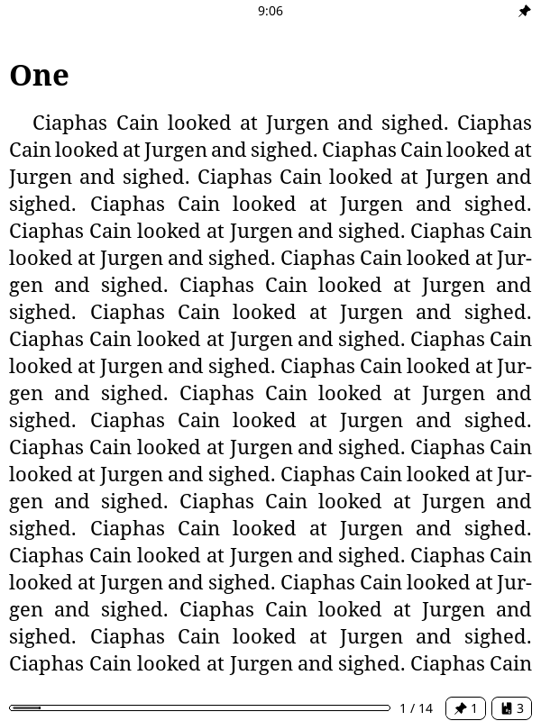
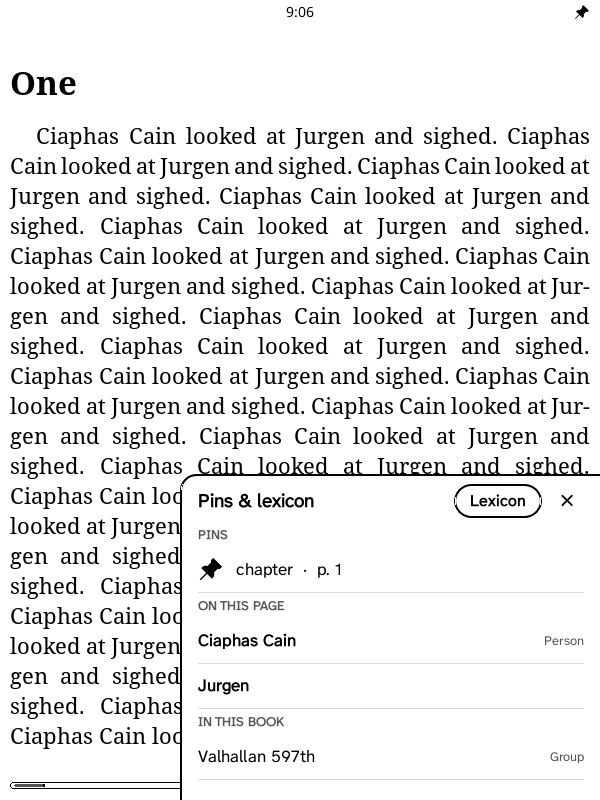
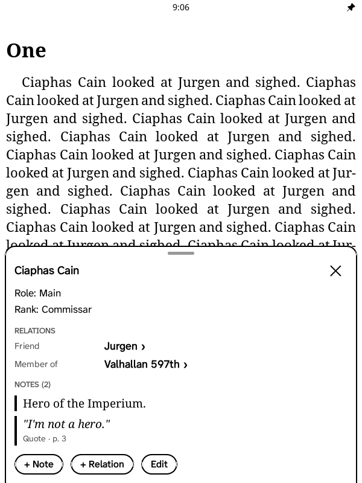
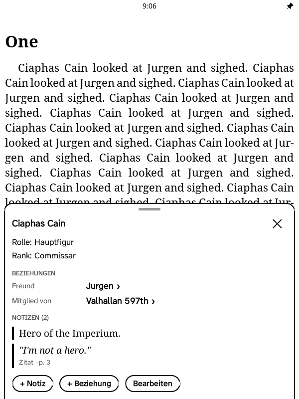

# Book lexicon: cards for the people, places and things of a book

This adds a lexicon for each book to the reader: cards for people, objects, groups, places and anything else you want to remember while reading. It is the in-ZenOS version of the [Book Lexicon](https://github.com/Lamberjoe/booklexicon.koplugin) test plugin that was shared on Discord.

## What it does

- **Status bar box.** A box with the lexicon icon and the number of cards sits right of the pin box. It is drawn by `pin_footer.lua`, so it has the same style, theme colours and touch handling. Tap it to open the **Pins & Lexicon** window, which lists the pins and the names on the current page. By default the box only shows when the book has cards (*Tools › Lexicon › Lexicon box in the status bar*: Always / Only with cards / Never).
- **Gestures.** Full-screen lexicon pages never pass taps or sideways swipes to the book underneath. A swipe down from the top edge (menu and quick settings) or up from the bottom edge still reaches the reader.
- **Long-press a name.** If the name has a card, the card opens instead of the dictionary, and the dictionary stays one tap away.
- **Highlight menu › Lexicon.** Makes a card for the selected name, or adds the selected text to a card as a quote.
- **Cards.** Each card has a kind, other names, facts, notes and quotes, a picture (from the book or a JPG/PNG), and relations. A relation is added on both cards, e.g. *Member of* ↔ *Has member*. Relation types can be edited.
- **Plain files.** Each book has one Markdown file, `koreader/lexicon/Books/<Author - Title>/lexicon.md`, next to its pictures. The file can be edited on a PC, and the previous version is kept as `lexicon.md.bak`.
  - Saving writes a temporary file and renames it, so a power loss never leaves half a file.
  - A file changed on a PC while a card is open is never overwritten.
  - The folder is remembered in the book's settings (`zen_lexicon_dir`), so the lexicon stays with the book when its title or author is edited later.

## Screenshots

| Status bar (pin + lexicon box) | Pins & Lexicon window | Card | Card (German) |
|---|---|---|---|
|  |  |  |  |

## Integration

- A new feature flag, `features.book_lexicon`, is on by default. It shows up as *Reader settings › Lexicon › Book lexicon*, and *Relation types* is in the same place. Switching it on or off applies to the open book right away.
- `modules/reader/patches/book_lexicon.lua` is a reader feature like `reader_references`. It patches `ReaderDictionary.onLookupWord` for the long-press lookup and registers one `zen_lexicon` controller per `ReaderUI`.
- `pin_footer.lua` gets `M.addBox{ id, icon, visible, count, tap, hold }`. The pin box is now the first entry of that list, and its behaviour and fields (`_zen_pin_label`, `_zen_pin_dimen`, the inline reservation) stay the same. The lexicon adds its box through that function and has no status bar code of its own.
- Name lookups go through a per-lexicon index (normalised names and words). The index is rebuilt only after a save or a change on the PC, so a long-press costs one table lookup. Matching part of a name only happens for words written like names, e.g. "Nev", not "black".
- The code lives in `modules/reader/lexicon/`. `store.lua` holds the data and the Markdown parser/writer, and has no UI. The windows, card, status bar box and pills are separate files.
- Pins are only read, through `modules/reader/references` (`pins`, `pageLabel`, `openPinned`).
- New icons from Material Design Icons: `lexicon.svg` (mdi:book-alphabet) and `lexicon_picture.svg` (mdi:image-outline). Both are listed in `icons/LICENSES.txt`.
- All UI strings use `_()`. New entries are in `locales/en.po` and in `locales/de.po` with German translations. The other catalogs are left for the usual sync.

## Tests

- `spec/lua/unit/book_lexicon_store_spec.lua` covers:
  - parsing and writing the file round trip
  - finding cards by other names and grammatical forms through the index
  - relations on both cards, and renames
  - roles kept as English words in the file and shown translated
  - the folder staying with the book after a title change
  - not overwriting a file changed elsewhere
  - the feature switch and the translated labels
- `spec/lua/unit/pin_footer_spec.lua` has a new case: a second box right of the pin box, and the room it takes in the status bar.
- `spec/python/tests/test_emulator_book_lexicon.py` opens a book with a lexicon file. It checks the status bar box (alone and next to a pin), the Pins & Lexicon window and the card from a long-press (also by another name). It also checks that swipes on a lexicon page never turn the book page, that a swipe down from the top edge opens the reader menu, and that the lexicon is fully inactive when the feature is off. It adds a `lexicon_action` command to the test driver.
- New files are listed in `spec/runtime-modules.txt`. `reader_settings_spec` expects the new *Lexicon* entry.
- `./spec/run smoke` (Lua: 2950 passed; Python: 320 passed, 17 skipped), `./spec/run package-check` and LuaCheck pass locally against KOReader v2026.07.

## Open for your decision

- Default on, with the box only for books that have cards. Should it be off by default instead?
- For existing German lexicons, the folder is `Bücher/` when KOReader runs in German or when that folder already exists. This keeps the test plugin's files working.

🤖 Generated with [Claude Code](https://claude.com/claude-code)

https://claude.ai/code/session_01Shtr93M44hkhDPqL2aAQFp
