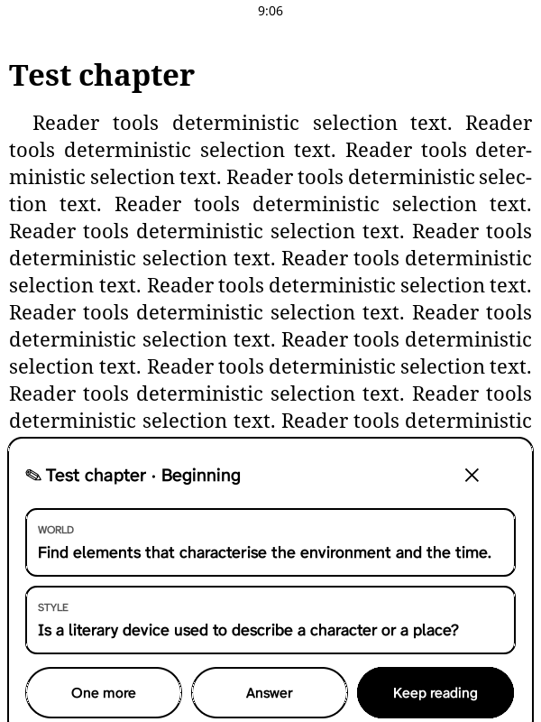

# Thoughtful Reading: book club questions at the end of chapters

This adds book club style questions to the reader. It works fully offline and needs no AI. At the end of a chapter a small card shows questions that fit the part of the book you are in: beginning, middle or end. You can answer in a few words, attach one of your highlights, tick *Noted in my journal*, or just keep reading.

## What it does

- **Question card at chapter ends.** It shows two questions from different categories (plot, point of view, characters, world, themes, style, prediction, personal). Answered questions never come back. In volume 2 and later of a series, a series question comes first.
- **How often.** Every chapter end, every 3rd chapter, only beginning/middle/end, or never (then only through *Ask me now*). The number of questions per stop can be 1 to 3.
- **Highlights.** A highlight you made in that chapter can become a question.
- **Lexicon questions (optional).** If the book has a lexicon file (`koreader/lexicon/Books/<Author - Title>/lexicon.md`), one question after 40 % and one at the end are about a main character. Main characters are found by counting name mentions. The lexicon is only read, never written.
- **Answers.** *Tools › Thoughtful Reading* has the answers of the book and *All books* (also in the library, sorted by last answer). Answers can be exported as Markdown, for one book or all books.
- **Questions file.** It is a plain text file with one question per line (`section | category | tags | question`). Tags restrict a question to genres, e.g. `crime, thriller`, or to nonfiction. The questions can be edited on the device, and the user's own list is saved to `koreader/settings/thoughtfulreading_questions.txt`.

## Screenshots

| Question card | Question card (German UI) |
|---|---|
|  |  |

## Integration

- A new feature flag, `features.thoughtful_reading`, is **off by default**, because the card interrupts reading. It shows up as *Reader settings › Thoughtful Reading*. Switching it on attaches the controller to the open library and book right away.
- `ZenUI:init` calls `thoughtful_reading/controller.attach(self.ui, self)`, so the library (*All books*, export) and the reader each get one controller.
- The code lives in `modules/reader/thoughtful_reading/`. `questions.lua` and `lexicon.lua` are pure Lua (question file, picking, tags, name counting). `controller.lua` holds the reader and library logic. `ui.lua` has the card and pages. `questions.txt` is the standard list.
- Answers are stored per book in the doc settings (`thoughtful_reading`). The global settings and the index of books with answers are in `G_reader_settings`.
- Chapter stops are keyed by chapter number, and reading positions are stored as a share of the book. A new layout (font, margins, rotation) therefore neither repeats nor skips a stop. The chapter list is rebuilt on `DocumentRerendered` and `UpdateToc`.
- Names are counted in one pass over the words, and only while a lexicon question can still come. The book lexicon's remembered folder (`zen_lexicon_dir`) is used when present.
- New icon: `thoughtful_reading.svg` (mdi:comment-question-outline), listed in `icons/LICENSES.txt`.
- All UI strings use `_()`. New entries are in `locales/en.po` and in `locales/de.po` with German translations. The standard questions themselves are English for now.

## Tests

- `spec/lua/unit/thoughtful_reading_spec.lua` covers the question file round trip, tags and nonfiction matching, picking (different categories, no answered questions, series questions), book sections, the shipped question file, and the lexicon reading and name counting with main and side characters.
- `spec/python/tests/test_emulator_thoughtful_reading.py` checks that with the feature on, the library and the reader get their controller and *Ask me now* shows the question card. With the feature off, nothing is added. It adds a `thoughtful_reading_action` command to the test driver.
- New files are listed in `spec/runtime-modules.txt`. `reader_settings_spec` expects the new *Thoughtful Reading* entry.
- `./spec/run smoke` (Lua: 2945 passed; Python: 320 passed, 17 skipped), `./spec/run package-check` and LuaCheck pass locally against KOReader v2026.07.

## Open for your decision

- Off by default. Is that right for ZenOS?
- The standard questions are not translated yet. They could become a `_()` list if you prefer.

🤖 Generated with [Claude Code](https://claude.com/claude-code)

https://claude.ai/code/session_01Shtr93M44hkhDPqL2aAQFp
